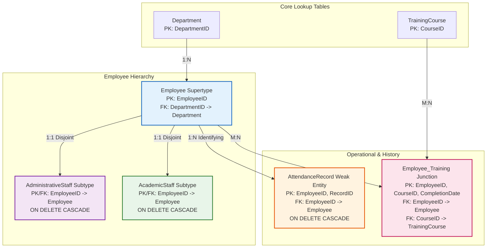

# פרויקט מסדי נתונים - שלב א'
# מערכת ניהול כוח אדם למכללה (College Manpower & HR System)

---

## שער (Cover Page)
* **שם המערכת:** מערכת ניהול כוח אדם למכללה (התאמה למרכז האקדמי לב / JCT)
* **מוגש על ידי:** יואל מ. (Yoel M.)
* **תעודת זהות:** 329821532
* **קורס:** בסיסי נתונים - שלב א' (Relational Database Design & Implementation)
* **מוסד אקדמי:** המרכז האקדמי לב (Jerusalem College of Technology)
* **סביבת פיתוח ובסיס נתונים:** PostgreSQL 16+, Docker Compose, pgAdmin 4, Python 3 (Faker)
* **תאריך הגשה:** נובמבר 2026

---

## תוכן עניינים (Table of Contents)
1. [שער](#שער-cover-page)
2. [תוכן עניינים](#תוכן-עניינים-table-of-contents)
3. [מבוא ומטרת המערכת](#מבוא-ומטרת-המערכת)
   - [מטרות המערכת](#מטרות-המערכת)
   - [קישור למסכי המערכת](#קישור-למסכי-המערכת-ui-mockups)
4. [תרשימים (ERD & DSD)](#תרשימים-erd--dsd)
   - [תרשים ישויות וקשרים (ERD)](#תרשים-ישויות-וקשרים-erd)
   - [תרשים מבנה נתונים וסכמה (DSD)](#תרשים-מבנה-נתונים-וסכמה-dsd)
5. [החלטות עיצוב (Design Decisions)](#החלטות-עיצוב-design-decisions)
   - [ירושה ותת-סוגים (Supertype / Subtype)](#1-שימוש-בירושה-supertypesubtype-עבור-סגל-העובדים)
   - [ישות חלשה עבור דיווחי נוכחות (Weak Entity)](#2-שימוש-בישות-חלשה-weak-entity-עבור-שעון-נוכחות)
   - [קשר רבים-לרבים להשתלמויות (M:N Junction Table)](#3-קשר-רבים-לרבים-mn-עבור-קורסי-הדרכה-והשתלמויות)
   - [עמידה בצורה נורמלית שלישית (3NF Normalization)](#4-נרמול-לרמת-3nf)
6. [אכלוס הנתונים (Data Population)](#אכלוס-הנתונים-data-population)
   - [שיטה 1: סקריפט Python וספריית Faker (40,000 רשומות)](#שיטה-1-סקריפט-python-וספריית-faker)
   - [שיטה 2: מחולל נתונים Mockaroo (500 רשומות)](#שיטה-2-מחולל-נתונים-mockaroo)
   - [שיטה 3: הזנה ידנית SQL (מחלקות וקורסים)](#שיטה-3-הזנה-ידנית-manual-sql-import)
   - [טבלת סיכום כמות שורות במערכת](#טבלת-סיכום-כמות-שורות-במערכת)
7. [גיבוי ושחזור (Backup & Restore)](#גיבוי-ושחזור-backup--restore)
   - [תהליך הגיבוי באמצעות pgAdmin 4](#תהליך-הגיבוי-באמצעות-pgadmin-4)
   - [תהליך השחזור באמצעות pgAdmin 4](#תהליך-השחזור-באמצעות-pgadmin-4)
   - [גיבוי ושחזור באמצעות שורת הפקודה (CLI)](#גיבוי-ושחזור-באמצעות-שורת-הפקודה-cli)
8. [הוראות הרצה מהירה (Execution Guide)](#הוראות-הרצה-מהירה-execution-guide)

---

## מבוא ומטרת המערכת

### מטרות המערכת
מערכת **ניהול כוח אדם למכללה** (College Manpower & HR Management System) מיועדת לנהל, לתעד ולייעל את כלל תהליכי משאבי האנוש במרכז האקדמי לב (JCT). המערכת נותנת מענה מקיף לשלושה מוקדי פעילות מרכזיים:

1. **ניהול סגל רב-גוני (Employee & Staff Hierarchy):**  
   המכללה מעסיקה עובדים בעלי מאפיינים שונים בתכלית:
   - **סגל אקדמי (Academic Staff):** פרופסורים, מרצים, חוקרים וראשי מעבדות, עבורם יש לתעד תחומי מחקר, דרגות אקדמיות ומעמד קביעות.
   - **סגל מנהלי (Administrative Staff):** מנהלי מחלקות, עובדי לוגיסטיקה, רכש, כספים ומזכירות, עבורם יש לתעד מיקום משרד, אגף תפעולי ודרג ניהולי.  
   המערכת מיישמת ארכיטקטורת ירושה (Supertype/Subtype) המאפשרת שיתוף שדות משותפים (תעודת זהות, שכר בסיס, תאריך תחילת העסקה, שיוך מחלקתי) לצד שמירה מבודדת ומדויקת של שדות ייחודיים לכל סקטור ללא ערכי NULL מיותרים.

2. **מעקב נוכחות ושעון יומי (Attendance & Time Tracking):**  
   מעקב מדויק ומבוקר אחר כניסות ויציאות יומיות של עובדים. דיווח הנוכחות ממומש כ**ישות חלשה (Weak Entity)** התלויה בעובד, ומאפשרת הפקת דוחות נוכחות חודשיים, חישוב שעות נוספות ואיתור חריגות.

3. **הדרכות, בטיחות והשתלמויות מקצועיות (Faculty Training & Certifications):**  
   מעקב אחר קורסי הדרכה מגוונים – החל מרענוני בטיחות אש, עזרה ראשונה ובטיחות במעבדות לייזר, ועד סדנאות פדגוגיה חדשנית, כלי Generative AI בהוראה וסייבר. המערכת מנהלת קשר רבים-לרבים (M:N) בין העובדים לקורסים, כולל תיעוד תאריך השלמת הקורס לצורך מעקב תקופתי שנתי.

### קישור למסכי המערכת (UI Mockups)
סקיצות ומסכי המשתמש המתוכננים של המערכת (User Interface Prototypes) זמינים בקישור הבא:  
🔗 **[LINK TO GOOGLE AI STUDIO]**

---

## תרשימים (ERD & DSD)

### תרשים ישויות וקשרים (ERD)
תרשים ה-ERD ממחיש את הישויות במערכת, התכונות שלהן, והקשרים הסמנטיים (קשרי ירושה, ישות חלשה וקשר רבים-לרבים):

```mermaid
erDiagram
    Department ||--o{ Employee : "employs (1:N)"
    Employee ||--|| AdministrativeStaff : "is-a (Subtype 1:1)"
    Employee ||--|| AcademicStaff : "is-a (Subtype 1:1)"
    Employee ||--o{ AttendanceRecord : "clocks (Weak Entity 1:N)"
    Employee ||--o{ Employee_Training : "attends (M:N Junction)"
    TrainingCourse ||--o{ Employee_Training : "completed_by (M:N Junction)"

    Department {
        int DepartmentID PK
        string DepartmentName UK
        numeric Budget
    }

    Employee {
        int EmployeeID PK
        string FirstName
        string LastName
        string ID_Number UK
        date HireDate
        numeric BaseSalary
        int DepartmentID FK
        string EmployeeType
    }

    AdministrativeStaff {
        int EmployeeID PK_FK
        string OfficeNumber
        string ManagementLevel
    }

    AcademicStaff {
        int EmployeeID PK_FK
        string ResearchField
        string TenureStatus
    }

    AttendanceRecord {
        int EmployeeID PK_FK
        int RecordID PK
        date WorkDate
        time ClockInTime
        time ClockOutTime
    }

    TrainingCourse {
        int CourseID PK
        string CourseName UK
        string ProviderName
    }

    Employee_Training {
        int EmployeeID PK_FK
        int CourseID PK_FK
        date CompletionDate PK
    }
```

#### צילום מסך של תרשים ה-ERD:
  
*(Placeholder: יש להחליף בתמונת תרשים ה-ERD שהופק בכלי המידול)*

---

### תרשים מבנה נתונים וסכמה (DSD)
תרשים ה-DSD (Data Structure Diagram / Physical Relational Schema) מציג את מבנה הטבלאות הפיזי במסד הנתונים PostgreSQL, כולל מפתחות ראשיים (PK), מפתחות זרים (FK), אילוצי ערכים (CHECK/UNIQUE), וכללי מחיקה בהיררכיה:



#### צילום מסך של תרשים ה-DSD / Schema:
  
*(Placeholder: יש להחליף בתמונת תרשים ה-DSD או סכמת הטבלאות מ-pgAdmin / DBeaver)*

---

## החלטות עיצוב (Design Decisions)

### 1. שימוש בירושה (Supertype/Subtype) עבור סגל העובדים
במודל הנתונים נבחר דפוס **Table-per-Type (TPT)** / **Class Table Inheritance** לחלוקת עובדי המכללה:
* **ישות על (`Employee`):** מאגדת את המאפיינים המשותפים לכל מועסק במכללה – מספר זהות ייחודי, שמות, תאריך תחילת העסקה, שכר בסיס ושיוך למחלקה.
* **תת-סוג סגל מנהלי (`AdministrativeStaff`):** מרכז מאפיינים ייעודיים למנהלה ותפעול – מספר חדר/משרד (`OfficeNumber`) ודרג ניהולי (`ManagementLevel`).
* **תת-סוג סגל אקדמי (`AcademicStaff`):** מרכז מאפיינים ייעודיים למרצים וחוקרים – תחום מחקר (`ResearchField`) ומעמד קביעות אקדמית (`TenureStatus`).

**מדוע הועדף מודל זה על פני טבלה יחידה (Single Table with NULLs)?**
1. **שמירה קפדנית על נרמול 3NF:** הימנעות משדות אופציונליים מרובי ערכי `NULL` מיותרים (Anti-pattern).
2. **אכיפת אילוצי שלמות (Integrity Constraints):** במודל תת-סוגים ניתן להגדיר אילוץ `NOT NULL` ובדיקת תקינות (`CHECK`) על `ResearchField` עבור סגל אקדמי, מבלי לפגוע בסגל מנהלי.
3. **מודל זר ומלא (Disjoint & Total Specialization):** כל עובד הוא בהכרח סגל מנהלי או סגל אקדמי, אך לעולם לא שניהם יחד באותו תפקיד. המפתח הראשי של תת-הסוג הוא `EmployeeID`, המהווה בו-זמנית גם מפתח זר (`FK`) המפנה לישות האב עם מחיקה תלויה (`ON DELETE CASCADE`).

---

### 2. שימוש בישות חלשה (Weak Entity) עבור שעון נוכחות
טבלת `AttendanceRecord` מוגדרת במפורש כ**ישות חלשה (Weak Entity)** התלויה בישות האב `Employee`:
* **חוסר קיום עצמאי (Existence Dependency):** רשומת נוכחות בשעון אינה בעלת משמעות או קיום ללא העובד שביצע את ההחתמה. אם עובד נמחק מהמערכת, כל דיווחי הנוכחות שלו נמחקים מיידית (`ON DELETE CASCADE`).
* **מפתח חלקי ומזהה (Identifying Relationship & Composite PK):**  
  המפתח הראשי של הטבלה מורכב מהשילוב: `(EmployeeID, RecordID)`.  
  `RecordID` משמש כמפתח חלקי (Discriminator) הממספר את הדיווחים של אותו עובד ספציפי, בעוד `EmployeeID` מהווה את המפתח הזר המזהה.
* **יתרון ביצועי ועסקי:** מבנה זה משקף נאמנה את אופי פעולת שעוני נוכחות, מבטיח אינדוקס ישיר ויעיל לשאילתות היסטוריות לפי עובד, ומונע יצירת מזהים גלובליים מלאכותיים שאינם נדרשים.

---

### 3. קשר רבים-לרבים (M:N) עבור קורסי הדרכה והשתלמויות
הקשר בין עובד לבין קורסי הדרכה ממומש באמצעות טבלת קשר אסוציאטיבית (`Employee_Training`):
* כל עובד יכול להשתתף במספר רב של קורסי הכשרה והשתלמויות לאורך שנות עבודתו.
* כל קורס הדרכה מועבר לקבוצות רבות של עובדים.
* **מפתח ראשי מורכב משולש `(EmployeeID, CourseID, CompletionDate)`:**  
  הכללת תאריך הסיום (`CompletionDate`) במפתח הראשי מאפשרת מעקב אחר **השתלמויות תקופתיות חוזרות** (כגון רענון שנתי בבטיחות אש, רענון עזרה ראשונה והדרכת סייבר שנתית) – תרחיש קריטי במוסד אקדמי המעסיק מעל 500 עובדים.

---

### 4. נרמול לרמת 3NF
* **1NF:** כל התכונות אטומיות. אין מערכים או שדות רב-ערכיים. לכל טבלה מפתח ראשי מוגדר.
* **2NF:** אין תלויות חלקיות. בטבלאות בעלות מפתח מורכב (`AttendanceRecord`, `Employee_Training`), כל תכונה שאינה מפתח תלויה במלוא המפתח.
* **3NF:** אין תלויות טרנזיטיביות. פרטי מחלקה (תקציב) אינם מאוחסנים בטבלת עובד; פרטי קורס (ספק הדרכה) אינם מאוחסנים בטבלת השתתפות עובדים.

---

## אכלוס הנתונים (Data Population)

על פי דרישות הפרויקט, הנתונים אוכלסו באמצעות **3 שיטות נפרדות**, כאשר עבור שתי טבלאות מרכזיות נוצרו **מעל 20,000 רשומות לכל אחת**:

```
                                  שיטות אכלוס הנתונים
┌─────────────────────────────────────────┬─────────────────────────────────────────┬─────────────────────────────────────────┐
│     שיטה 1: סקריפט Python (Faker)       │        שיטה 2: מחולל Mockaroo           │      שיטה 3: הזנה ידנית (Manual)        │
├─────────────────────────────────────────┼─────────────────────────────────────────┼─────────────────────────────────────────┤
│ • AttendanceRecord: 20,000 רשומות       │ • Employee: 500 רשומות                  │ • Department: 12 מחלקות מכללה           │
│ • Employee_Training: 20,000 רשומות      │ • AdministrativeStaff: 250 רשומות       │ • TrainingCourse: 18 קורסי הדרכה        │
│                                         │ • AcademicStaff: 250 רשומות             │                                         │
└─────────────────────────────────────────┴─────────────────────────────────────────┴─────────────────────────────────────────┘
```

---

### שיטה 1: סקריפט Python וספריית Faker
* **מיקום הקוד:** `DBProject_329821532/שלב א/Programing/generate_data.py`
* **קובץ ה-SQL שנוצר:** `DBProject_329821532/שלב א/Programing/insertTables_Python.sql`
* **תיאור הפעולה:**  
  הסקריפט משתמש בספריית `faker` ובמחוללי תאריכים מבוקרים ליצירת נתונים לוגיים ועקביים:
  - **20,000 רשומות נוכחות (`AttendanceRecord`):** 40 ימי עבודה לכל אחד מ-500 העובדים (ימי א'-ה', שעות כניסה ריאליות בבוקר ושעות יציאה לאחר 8-9 שעות עבודה).
  - **20,000 רשומות השתלמות (`Employee_Training`):** 40 רישומי סיום קורס לכל עובד, בחלוקה לקורסים שונים ותאריכים מגוונים.
  - כתיבה יעילה במנות (Batches של 1,000 רשומות בכל הצהרת `INSERT`) המבטיחה טעינה מהירה ביותר ב-PostgreSQL.

#### צילומי מסך - שיטת Python:
  
*(Placeholder: צילום מסך של קוד ה-Python בסביבת הפיתוח)*

  
*(Placeholder: צילום מסך של הרצת הסקריפט בטרמינל ויצירת הקובץ)*

---

### שיטה 2: מחולל נתונים Mockaroo
* **מיקום קבצי ההגדרה:** `DBProject_329821532/שלב א/mockarooFiles/`
  - סכמת הגדרות JSON: `mockaroo_schemas.json`
  - מדריך עבודה מפורט: `mockaroo_instructions.md`
  - קובץ SQL מוכן להרצה: `insertTables_Mockaroo.sql`
* **תיאור הפעולה:**  
  - הוגדרה סכמת 500 עובדים בעלי שמות פרטיים ומשפחה ישראליים, תעודות זהות בנות 9 ספרות ייחודיות, תאריכי גיוס מגוונים ומשכורות שוק אקדמיות.
  - סגל מנהלי (רשומות 1 עד 250) מקושר לחדרים בבנייני המכללה (בניין לב, שלום, נווה, טכנולוגי) ודרגים ניהוליים.
  - סגל אקדמי (רשומות 251 עד 500) מקושר לתחומי מחקר הנדסיים ומדעיים (למידת מכונה, אלקטרואופטיקה, קוונטים, ביו-אינפורמטיקה) ומעמדי קביעות.

#### צילומי מסך - שיטת Mockaroo:
  
*(Placeholder: צילום מסך מתוך אתר Mockaroo של סכמת העובדים)*

  
*(Placeholder: צילום מסך של הורדת קובץ הנתונים מהאתר)*

---

### שיטה 3: הזנה ידנית (Manual SQL Import)
* **מיקום הקובץ:** `DBProject_329821532/שלב א/DataImportFiles/insertTables_Manual.sql`
* **תיאור הפעולה:**  
  הזנה ישירה של נתוני תשתית (Lookup Tables) מותאמים אישית למרכז האקדמי לב:
  - **12 מחלקות מכללה:** הנדסת תוכנה, מדעי המחשב, אלקטרואופטיקה ופוטוניקה, הנדסת תעשייה וניהול, ביואינפורמטיקה, ניהול וחשבונאות, משאבי אנוש ושכר, לוגיסטיקה ורכש, מנהל סטודנטים, מערכות מידע, כספים ושיווק.
  - **18 קורסי הדרכה והשתלמות:** קורסי סייבר לאומי, פדגוגיה חדשנית, כתיבת הצעות מחקר לקרנות תחרותיות (ISF), הדרכות בטיחות אש, עזרה ראשונה, כלי בינה מלאכותית בהוראה, הנגשת השכלה לבעלי מוגבלויות ועוד.

#### צילומי מסך - הזנה ידנית:
  
*(Placeholder: צילום מסך של הרצת פקודות ה-INSERT הידניות ב-Query Tool)*

---

### טבלת סיכום כמות שורות במערכת

| שם הטבלה | סוג הישות | שיטת אכלוס הנתונים | כמות שורות מאוכלסות | דרישת המטלה | עמידה ביעד |
| :--- | :--- | :--- | :--- | :--- | :---: |
| **Department** | מחלקות (Parent) | שיטה 3: הזנה ידנית | **12** | 10+ מחלקות | ✅ |
| **TrainingCourse** | קטלוג קורסים (Parent) | שיטה 3: הזנה ידנית | **18** | 15+ קורסים | ✅ |
| **Employee** | עובדי מכללה (Supertype) | שיטה 2: Mockaroo | **500** | 500+ רשומות | ✅ |
| **AdministrativeStaff** | סגל מנהלי (Subtype) | שיטה 2: Mockaroo | **250** | חלק מ-500 עובדים | ✅ |
| **AcademicStaff** | סגל אקדמי (Subtype) | שיטה 2: Mockaroo | **250** | חלק מ-500 עובדים | ✅ |
| **AttendanceRecord** | שעון נוכחות (Weak Entity) | שיטה 1: Python Faker | **20,000** | **20,000+ רשומות** | ✅ |
| **Employee_Training** | השתלמויות (Junction M:N) | שיטה 1: Python Faker | **20,000** | **20,000+ רשומות** | ✅ |
| **סה"כ כללי במערכת** | | | **41,030 רשומות** | **יעד עבר בהצלחה** | **100%** |

---

## גיבוי ושחזור (Backup & Restore)

בסביבת מסדי נתונים מוסדיים ואקדמיים, מנגנון גיבוי ושחזור אמין מהווה מרכיב קריטי להבטחת שרידות המידע (Disaster Recovery & Business Continuity). להלן התיעוד המלא של ביצוע הגיבוי והשחזור במסד הנתונים PostgreSQL באמצעות ממשק **pgAdmin 4** ובאמצעות כלי ה-CLI.

### תהליך הגיבוי באמצעות pgAdmin 4
1. התחבר לממשק ה-Web של pgAdmin 4 (בדפדפן: `http://localhost:8080`).
2. בעץ האובייקטים (Object Explorer), נווט אל השרת והרחב את רשימת מסדי הנתונים (`Databases`).
3. לחץ קליק ימני על מסד הנתונים של הפרויקט (`college_hr_db`) ובחר באפשרות **Backup...**.
4. בחלונית הגיבוי:
   - **Filename:** הזן שם מלא ומיקום לשמירת קובץ הגיבוי, לדוגמה: `college_db_backup_stageA.dump`.
   - **Format:** בחר בפורמט `Custom` (פורמט בינארי גמיש ודחוס המאפשר שחזור סלקטיבי) או `Plain` (סקריפט SQL טקסטואלי מלא).
   - בלשונית **Dump options:** סמן `Pre-data`, `Data`, ו-`Post-data` על מנת לגבות הן את הסכמות והמפתחות והן את כל 41,000 הרשומות.
5. לחץ על כפתור **Backup**.
6. המתן להופעת ההודעה הירוקה: `Process completed successfully`.

#### צילום מסך של תהליך הגיבוי ב-pgAdmin:
  
*(Placeholder: צילום מסך של חלון הגדרות ה-Backup והודעת ההצלחה ב-pgAdmin)*

---

### תהליך השחזור באמצעות pgAdmin 4
1. במידת הצורך לשחזור בעקבות תקלה או בדיקת שחזור (Disaster Drill):
   - ניתן ליצור מסד נתונים חדש וריק, למשל: `college_hr_db_restored`.
2. לחץ קליק ימני על מסד הנתונים החדש ובחר **Restore...**.
3. בחלונית השחזור:
   - **Format:** בחר בפורמט התואם לקובץ הגיבוי (`Custom` או `Directory`).
   - **Filename:** בחר את קובץ הגיבוי שנוצר בשלב הקודם (`college_db_backup_stageA.dump`).
4. לחץ על כפתור **Restore**.
5. המתן להודעת הסיום: `Process completed successfully`.
6. פתח את ה-Query Tool והרץ את שאילתת הספירה מתוך `selectAll.sql` כדי לוודא שכל 41,030 הרשומות שוחזרו ללא דופי.

#### צילום מסך של תהליך השחזור ב-pgAdmin:
  
*(Placeholder: צילום מסך של חלון ה-Restore והודעת ההצלחה ב-pgAdmin)*

---

### גיבוי ושחזור באמצעות שורת הפקודה (CLI)
עבור אוטומציה וסקריפטים, ניתן לבצע גיבוי ושחזור ישירות מתוך הטרמינל או מתוך קונטיינר ה-Docker:

```bash
# 1. פקודת גיבוי מלא (pg_dump) בפורמט בינארי מותאם אישית:
docker exec -t PostgreSQL_DB pg_dump -U postgres -F c -b -v -f /tmp/college_hr_backup.dump college_hr_db

# העתקת קובץ הגיבוי מהקונטיינר למחשב המארח:
docker cp PostgreSQL_DB:/tmp/college_hr_backup.dump ./college_hr_backup.dump

# 2. פקודת שחזור מלא (pg_restore) למסד נתונים חדש:
docker exec -i PostgreSQL_DB pg_restore -U postgres -d college_hr_db_restored -v /tmp/college_hr_backup.dump
```

---

## הוראות הרצה מהירה (Execution Guide)

סדר הרצת הקבצים המומלץ והמדויק במסד הנתונים:

```bash
# שלב 1: הקמת סביבת Docker (PostgreSQL + pgAdmin) במידה ומשתמשים בקונטיינרים
docker-compose up -d

# שלב 2: יצירת מבנה הטבלאות (DDL)
psql -U postgres -d college_hr_db -f "DBProject_329821532/שלב א/createTables.sql"

# שלב 3: אכלוס נתוני בסיס (מחלקות וקורסים) - שיטה 3
psql -U postgres -d college_hr_db -f "DBProject_329821532/שלב א/DataImportFiles/insertTables_Manual.sql"

# שלב 4: אכלוס 500 עובדים וסגלים - שיטה 2 (Mockaroo)
psql -U postgres -d college_hr_db -f "DBProject_329821532/שלב א/mockarooFiles/insertTables_Mockaroo.sql"

# שלב 5: אכלוס 40,000 רשומות נוכחות והשתלמויות - שיטה 1 (Python)
psql -U postgres -d college_hr_db -f "DBProject_329821532/שלב א/Programing/insertTables_Python.sql"

# שלב 6: הרצת שאילתות בדיקה ווידוא כמויות
psql -U postgres -d college_hr_db -f "DBProject_329821532/שלב א/selectAll.sql"
```

ניתן להריץ את אותם הקבצים בדיוק גם דרך ה-**Query Tool** של **pgAdmin 4** באותו הסדר בדיוק.
אם נדרש איפוס ומחיקת הטבלאות, יש להריץ את הקובץ `dropTables.sql`.

