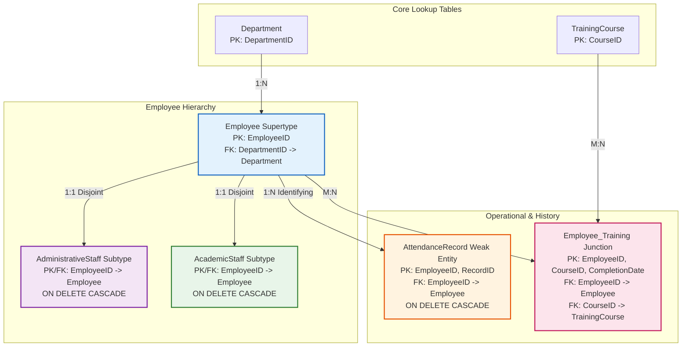

# Database Project - Phase A

# College Manpower & HR System

---

## Cover Page

* **System Name:** College Manpower & HR System (Adapted for Lev Academic Center / JCT)
* **Submitted by:** Yoel, ID: 329821532
Itay Ben Ami, ID: 215948415
* **Course:** Relational Database Design & Implementation - Phase A
* **Academic Institution:** Lev Academic Center (Jerusalem College of Technology)
* **Development Environment & Database:** PostgreSQL 16+, Docker Compose, pgAdmin 4, Python 3 (Faker)
* **Submission Date:** November 2026

---

## Table of Contents

1. [Cover Page](https://www.google.com/search?q=%23cover-page)
2. [Table of Contents](https://www.google.com/search?q=%23table-of-contents)
3. [Introduction and System Objectives](https://www.google.com/search?q=%23introduction-and-system-objectives)
* [System Objectives](https://www.google.com/search?q=%23system-objectives)
* [UI Mockups Link](https://www.google.com/search?q=%23ui-mockups-link)


4. [Diagrams (ERD & DSD)](https://www.google.com/search?q=%23diagrams-erd--dsd)
* [Entity-Relationship Diagram (ERD)](https://www.google.com/search?q=%23entity-relationship-diagram-erd)
* [Data Structure Diagram (DSD)](https://www.google.com/search?q=%23data-structure-diagram-dsd)


5. [Design Decisions](https://www.google.com/search?q=%23design-decisions)
* [Supertype / Subtype Inheritance](https://www.google.com/search?q=%231-supertypesubtype-inheritance-for-staff)
* [Weak Entity for Attendance](https://www.google.com/search?q=%232-weak-entity-for-attendance-clock)
* [M:N Junction Table for Training](https://www.google.com/search?q=%233-mn-many-to-many-relationship-for-training-and-certification-courses)
* [3NF Normalization](https://www.google.com/search?q=%234-3nf-normalization)


6. [Data Population](https://www.google.com/search?q=%23data-population)
* [Method 1: Python Script and Faker Library (40,000 records)](https://www.google.com/search?q=%23method-1-python-script-and-faker-library)
* [Method 2: Mockaroo Data Generator (500 records)](https://www.google.com/search?q=%23method-2-mockaroo-data-generator)
* [Method 3: Manual SQL Import (Departments and Courses)](https://www.google.com/search?q=%23method-3-manual-sql-import)
* [System Row Count Summary Table](https://www.google.com/search?q=%23system-row-count-summary-table)


7. [Backup & Restore](https://www.google.com/search?q=%23backup--restore)
* [Backup Process via pgAdmin 4](https://www.google.com/search?q=%23backup-process-via-pgadmin-4)
* [Restore Process via pgAdmin 4](https://www.google.com/search?q=%23restore-process-via-pgadmin-4)
* [CLI Backup & Restore](https://www.google.com/search?q=%23cli-backup--restore)


8. [Execution Guide](https://www.google.com/search?q=%23execution-guide)

---

## Introduction and System Objectives

### System Objectives

The **College Manpower & HR Management System** is designed to manage, document, and streamline all human resources processes. The system provides a comprehensive solution for three main operational areas:

1. **Diverse Staff Hierarchy (Employee & Staff Hierarchy):**
The college employs staff with fundamentally different characteristics:
* **Academic Staff:** Professors, lecturers, researchers, and lab heads, for whom research fields, academic ranks, and tenure status must be recorded.
* **Administrative Staff:** Department managers, logistics personnel, procurement, finance, and secretarial staff, for whom office locations, operational divisions, and management levels must be documented.
The system implements a Supertype/Subtype architecture that allows sharing common fields (ID, base salary, hire date, department affiliation) alongside isolated and precise storage of sector-specific fields without unnecessary NULL values.


2. **Daily Attendance and Time Tracking:**
Accurate and controlled tracking of employees' daily clock-ins and clock-outs. Attendance reporting is implemented as a **Weak Entity** dependent on the employee, enabling the generation of monthly attendance reports, overtime calculation, and anomaly detection.
3. **Training, Safety, and Professional Certifications:**
Tracking diverse training courses—ranging from fire safety refreshers, first aid, and laser lab safety, to innovative pedagogy workshops, Generative AI in teaching, and cybersecurity. The system manages a Many-to-Many (M:N) relationship between employees and courses, including documenting the completion date for annual periodic tracking.

### UI Mockups Link

The planned UI prototypes and user interface mockups for the system are available at the following link:

🔗 https://ai.studio/apps/26c68d43-b8ed-48e8-93e4-edd17ac53a6a?fullscreenApplet=true


---

## Diagrams (ERD & DSD)

### Entity-Relationship Diagram (ERD)

The ERD illustrates the system's entities, their attributes, and semantic relationships (inheritance, weak entities, and many-to-many relationships):

```mermaid
erDiagram
    Department ||--o{ Employee : "employs (1:N)"
    Employee ||--|| AdministrativeStaff : "is-a (Subtype 1:1)"
    Employee ||--|| AcademicStaff : "is-a (Subtype 1:1)"
    Employee ||--o{ AttendanceRecord : "clocks (Weak Entity 1:N)"
    Employee ||--o{ Employee_Training : "attends (M:N Junction)"
    TrainingCourse ||--o{ Employee_Training : "completed_by (M:N Junction)"

    Department {
        int DepartmentID PK
        string DepartmentName UK
        numeric Budget
    }

    Employee {
        int EmployeeID PK
        string FirstName
        string LastName
        string ID_Number UK
        date HireDate
        numeric BaseSalary
        int DepartmentID FK
        string EmployeeType
    }

    AdministrativeStaff {
        int EmployeeID PK_FK
        string OfficeNumber
        string ManagementLevel
    }

    AcademicStaff {
        int EmployeeID PK_FK
        string ResearchField
        string TenureStatus
    }

    AttendanceRecord {
        int EmployeeID PK_FK
        int RecordID PK
        date WorkDate
        time ClockInTime
        time ClockOutTime
    }

    TrainingCourse {
        int CourseID PK
        string CourseName UK
        string ProviderName
    }

    Employee_Training {
        int EmployeeID PK_FK
        int CourseID PK_FK
        date CompletionDate PK
    }

```

#### ERD Screenshot:

*(Placeholder: Replace with the ERD image generated in the modeling tool)*

---

### Data Structure Diagram (DSD)

The DSD (Physical Relational Schema) displays the physical table structure in the PostgreSQL database, including Primary Keys (PK), Foreign Keys (FK), value constraints (CHECK/UNIQUE), and hierarchical deletion rules:



#### DSD / Schema Screenshot:

*(Placeholder: Replace with the DSD image or table schema from pgAdmin / DBeaver)*

---

## Design Decisions

### 1. Supertype/Subtype Inheritance for Staff

A **Table-per-Type (TPT)** / **Class Table Inheritance** pattern was chosen for the college staff data model:

* **Supertype Entity (`Employee`):** Consolidates attributes common to all college employees—unique ID number, names, hire date, base salary, and department affiliation.
* **Administrative Staff Subtype (`AdministrativeStaff`):** Centralizes administration and operations-specific attributes—office/room number (`OfficeNumber`) and management level (`ManagementLevel`).
* **Academic Staff Subtype (`AcademicStaff`):** Centralizes lecturer and researcher-specific attributes—research field (`ResearchField`) and academic tenure status (`TenureStatus`).

**Why was this model preferred over a Single Table with NULLs?**

1. **Strict adherence to 3NF:** Avoids optional fields with multiple unnecessary `NULL` values (an anti-pattern).
2. **Enforcing Integrity Constraints:** The subtype model allows for `NOT NULL` constraints and validity checks (`CHECK`) on `ResearchField` for academic staff without impacting administrative staff.
3. **Disjoint & Total Specialization:** Every employee is exclusively either administrative or academic, never both in the same role. The subtype's primary key is `EmployeeID`, which simultaneously serves as a foreign key (`FK`) referencing the parent entity with a dependent deletion rule (`ON DELETE CASCADE`).

---

### 2. Weak Entity for Attendance Clock

The `AttendanceRecord` table is explicitly defined as a **Weak Entity** dependent on the parent `Employee` entity:

* **Existence Dependency:** A time-clock attendance record has no meaning or existence without the employee who clocked it. If an employee is deleted from the system, all their attendance records are immediately deleted (`ON DELETE CASCADE`).
* **Identifying Relationship & Composite PK:**
The table's primary key consists of the combination: `(EmployeeID, RecordID)`.
`RecordID` serves as a partial key (Discriminator) that numbers the records for that specific employee, while `EmployeeID` acts as the identifying foreign key.
* **Performance and Business Advantage:** This structure accurately reflects the nature of time-clock operations, ensures direct and efficient indexing for historical queries per employee, and prevents the creation of unnecessary artificial global identifiers.

---

### 3. M:N (Many-to-Many) Relationship for Training and Certification Courses

The relationship between an employee and training courses is implemented via an associative junction table (`Employee_Training`):

* Each employee can participate in multiple training courses and certifications throughout their employment.
* Each training course is delivered to many groups of employees.
* **Tripartite Composite Primary Key `(EmployeeID, CourseID, CompletionDate)`:**
Including the `CompletionDate` in the primary key enables tracking of **recurring periodic certifications** (such as annual fire safety refreshers, first aid renewals, and annual cyber training)—a critical scenario in an academic institution employing over 500 staff members.

---

### 4. 3NF Normalization

* **1NF:** All attributes are atomic. There are no arrays or multi-valued fields. Every table has a defined primary key.
* **2NF:** No partial dependencies exist. In tables with composite keys (`AttendanceRecord`, `Employee_Training`), every non-key attribute depends on the entire key.
* **3NF:** No transitive dependencies exist. Department details (budget) are not stored in the employee table; course details (training provider) are not stored in the employee participation table.

---

## Data Population

Per the project requirements, data was populated using **3 distinct methods**, generating **over 20,000 records each** for two core tables:

```text
                                  Data Population Methods
┌─────────────────────────────────────────┬─────────────────────────────────────────┬─────────────────────────────────────────┐
│     Method 1: Python Script (Faker)     │        Method 2: Mockaroo Gen.          │       Method 3: Manual SQL Import       │
├─────────────────────────────────────────┼─────────────────────────────────────────┼─────────────────────────────────────────┤
│ • AttendanceRecord: 20,000 records      │ • Employee: 500 records                 │ • Department: 12 college departments    │
│ • Employee_Training: 20,000 records     │ • AdministrativeStaff: 250 records      │ • TrainingCourse: 18 training courses   │
│                                         │ • AcademicStaff: 250 records            │                                         │
└─────────────────────────────────────────┴─────────────────────────────────────────┴─────────────────────────────────────────┘

```

---

### Method 1: Python Script and Faker Library

* **Code Location:** `DBProject_329821532/שלב א/Programing/generate_data.py`
* **Generated SQL File:** `DBProject_329821532/שלב א/Programing/insertTables_Python.sql`
* **Operation Description:**
The script utilizes the `faker` library and controlled date generators to create logical, consistent data:
* **20,000 Attendance Records (`AttendanceRecord`):** 40 workdays for each of the 500 employees (Sunday-Thursday, realistic morning clock-in times, and clock-outs after 8-9 hours of work).
* **20,000 Training Records (`Employee_Training`):** 40 course completion records per employee, distributed across various courses and dates.
* Highly efficient batch writing (Batches of 1,000 records per `INSERT` statement) ensuring extremely fast loading in PostgreSQL.


#### Screenshots - Python Method:

*(Placeholder: Screenshot of the Python code in the IDE)*

*(Placeholder: Screenshot of script execution in the terminal generating the file)*

---

### Method 2: Mockaroo Data Generator

* **Configuration Files Location:** `DBProject_329821532/שלב א/mockarooFiles/`
* JSON Definitions Schema: `mockaroo_schemas.json`
* Detailed Workflow Guide: `mockaroo_instructions.md`
* Ready-to-run SQL File: `insertTables_Mockaroo.sql`


* **Operation Description:**
* Configured a schema of 500 employees with Israeli first and last names, unique 9-digit ID numbers, varied hire dates, and academic-market salaries.
* Administrative staff (records 1 to 250) are linked to rooms in college buildings (Lev Building, Shalom, Naveh, Technology) and management levels.
* Academic staff (records 251 to 500) are linked to engineering and scientific research fields (Machine Learning, Electro-optics, Quantum, Bioinformatics) and tenure statuses.


#### Screenshots - Mockaroo Method:

*(Placeholder: Screenshot from the Mockaroo website of the employee schema)*

*(Placeholder: Screenshot downloading the data file from the site)*

---

### Method 3: Manual SQL Import

* **File Location:** `DBProject_329821532/שלב א/DataImportFiles/insertTables_Manual.sql`
* **Operation Description:**
Direct entry of infrastructure data (Lookup Tables) customized for the Lev Academic Center:
* **12 College Departments:** Software Engineering, Computer Science, Electro-optics & Photonics, Industrial Engineering & Management, Bioinformatics, Management & Accounting, HR & Payroll, Logistics & Procurement, Student Administration, Information Systems, Finance, and Marketing.
* **18 Training & Certification Courses:** National Cyber Courses, Innovative Pedagogy, Writing Research Proposals for Competitive Grants (ISF), Fire Safety Training, First Aid, AI Tools in Teaching, Accessibility in Higher Education, and more.


#### Screenshots - Manual Import:

*(Placeholder: Screenshot executing the manual INSERT commands in the Query Tool)*

---

### System Row Count Summary Table

| Table Name | Entity Type | Data Population Method | Populated Rows Count | Assignment Requirement | Target Met |
| --- | --- | --- | --- | --- | --- |
| **Department** | Departments (Parent) | Method 3: Manual Import | **12** | 10+ departments | ✅ |
| **TrainingCourse** | Course Catalog (Parent) | Method 3: Manual Import | **18** | 15+ courses | ✅ |
| **Employee** | College Staff (Supertype) | Method 2: Mockaroo | **500** | 500+ records | ✅ |
| **AdministrativeStaff** | Admin Staff (Subtype) | Method 2: Mockaroo | **250** | Part of the 500 | ✅ |
| **AcademicStaff** | Academic Staff (Subtype) | Method 2: Mockaroo | **250** | Part of the 500 | ✅ |
| **AttendanceRecord** | Time Clock (Weak Entity) | Method 1: Python Faker | **20,000** | **20,000+ records** | ✅ |
| **Employee_Training** | Certifications (Junction M:N) | Method 1: Python Faker | **20,000** | **20,000+ records** | ✅ |
| **Grand Total in System** |  |  | **41,030 records** | **Goal Achieved** | **100%** |

---

## Backup & Restore

In institutional and academic database environments, a reliable backup and restore mechanism is a critical component for ensuring data survivability (Disaster Recovery & Business Continuity). Below is the complete documentation for performing backups and restores on the PostgreSQL database via the **pgAdmin 4** interface and the CLI tool.

### Backup Process via pgAdmin 4

1. Connect to the pgAdmin 4 Web interface (in browser: `http://localhost:8080`).
2. In the Object Explorer tree, navigate to the server and expand the `Databases` list.
3. Right-click the project database (`college_hr_db`) and select the **Backup...** option.
4. In the backup dialog:
* **Filename:** Enter a full name and location to save the backup file, e.g., `college_db_backup_stageA.dump`.
* **Format:** Select `Custom` (a flexible, compressed binary format allowing selective restores) or `Plain` (a full textual SQL script).
* In the **Dump options** tab: Check `Pre-data`, `Data`, and `Post-data` to back up schemas, keys, and all 41,000 records.


5. Click the **Backup** button.
6. Wait for the green notification: `Process completed successfully`.

#### pgAdmin Backup Screenshot:

*(Placeholder: Screenshot of the Backup settings window and success message in pgAdmin)*

---

### Restore Process via pgAdmin 4

1. If a restore is needed due to failure or a Disaster Drill:
* You can create a new, empty database, e.g., `college_hr_db_restored`.


2. Right-click the new database and select **Restore...**.
3. In the restore dialog:
* **Format:** Select the format matching the backup file (`Custom` or `Directory`).
* **Filename:** Select the backup file generated in the previous step (`college_db_backup_stageA.dump`).


4. Click the **Restore** button.
5. Wait for the completion notification: `Process completed successfully`.
6. Open the Query Tool and run the counting query from `selectAll.sql` to verify that all 41,030 records were restored flawlessly.

#### pgAdmin Restore Screenshot:

*(Placeholder: Screenshot of the Restore window and success message in pgAdmin)*

---

### CLI Backup & Restore

For automation and scripts, backups and restores can be executed directly from the terminal or from within the Docker container:

```bash
# 1. Full backup command (pg_dump) in custom binary format:
docker exec -t PostgreSQL_DB pg_dump -U postgres -F c -b -v -f /tmp/college_hr_backup.dump college_hr_db

# Copying the backup file from the container to the host machine:
docker cp PostgreSQL_DB:/tmp/college_hr_backup.dump ./college_hr_backup.dump

# 2. Full restore command (pg_restore) to a new database:
docker exec -i PostgreSQL_DB pg_restore -U postgres -d college_hr_db_restored -v /tmp/college_hr_backup.dump

```

---

## Execution Guide

The recommended and exact order for executing the files in the database:

```bash
# Step 1: Set up the Docker environment (PostgreSQL + pgAdmin) if using containers
docker-compose up -d

# Step 2: Create the table structure (DDL)
psql -U postgres -d college_hr_db -f "DBProject_329821532/שלב א/createTables.sql"

# Step 3: Populate baseline data (departments and courses) - Method 3
psql -U postgres -d college_hr_db -f "DBProject_329821532/שלב א/DataImportFiles/insertTables_Manual.sql"

# Step 4: Populate 500 employees and staff - Method 2 (Mockaroo)
psql -U postgres -d college_hr_db -f "DBProject_329821532/שלב א/mockarooFiles/insertTables_Mockaroo.sql"

# Step 5: Populate 40,000 attendance and training records - Method 1 (Python)
psql -U postgres -d college_hr_db -f "DBProject_329821532/שלב א/Programing/insertTables_Python.sql"

# Step 6: Run test queries and verify row counts
psql -U postgres -d college_hr_db -f "DBProject_329821532/שלב א/selectAll.sql"

```

You can execute exactly the same files in identical order using the **Query Tool** in **pgAdmin 4**.
If you need to reset and drop the tables, execute the `dropTables.sql` file.


![attendence]
(C:\Users\yoelm\source\repos\DBProject\.git\collegeProject\screen shots\screen shots/attendence.png)

![dashboard]
(C:\Users\yoelm\source\repos\DBProject\.git\collegeProject\screen shots\screen shots/dash board.png)


