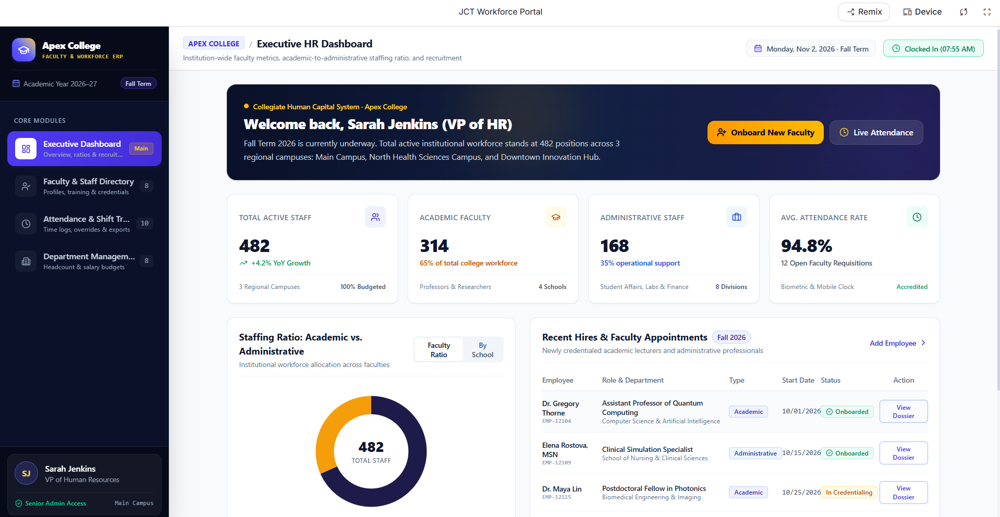
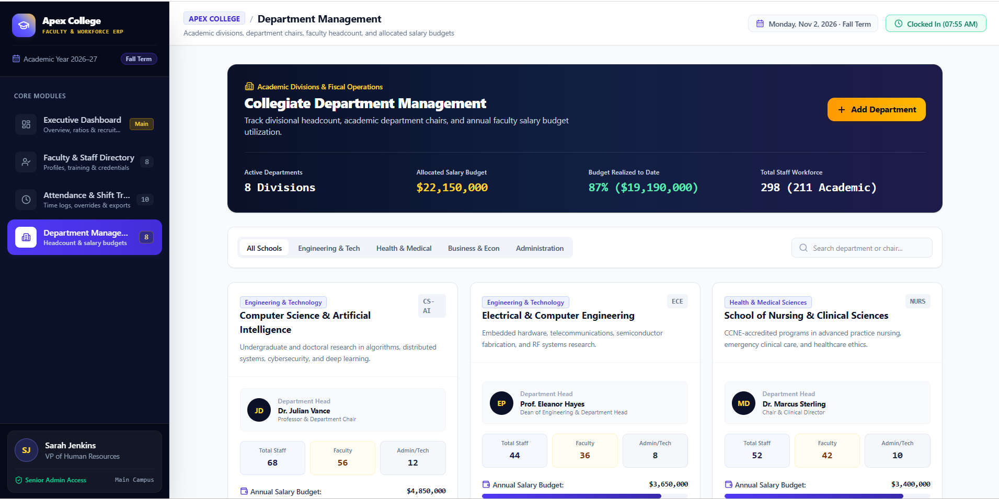
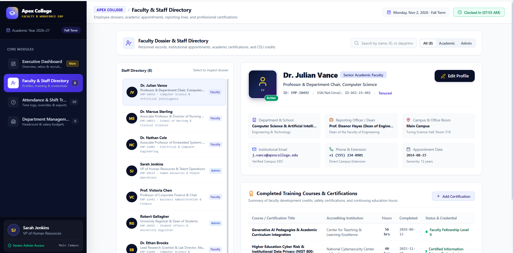
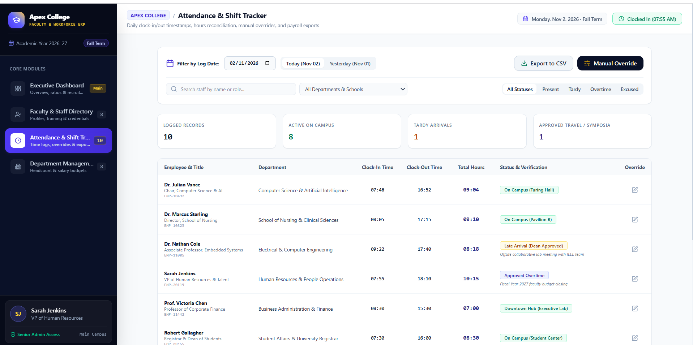
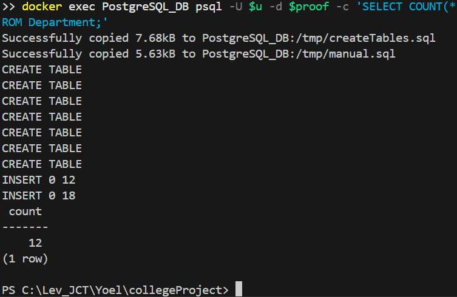
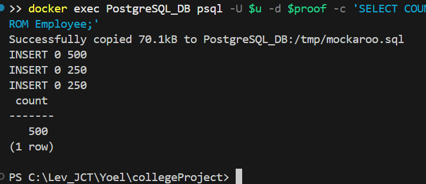
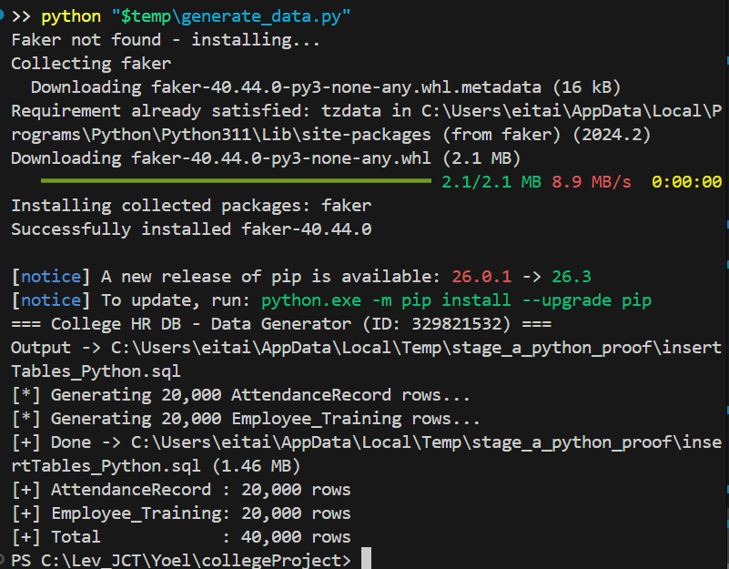
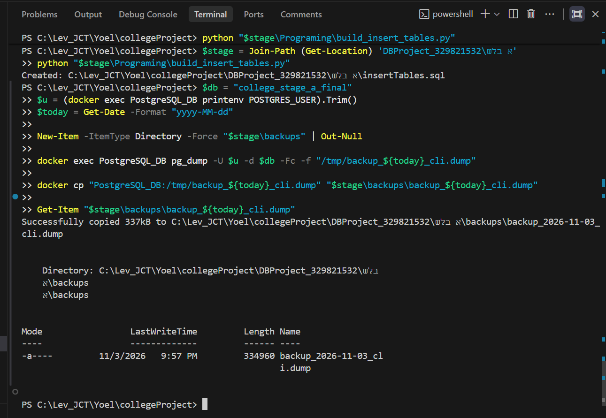

# פרויקט מסדי נתונים — שלב א׳

# מערכת ניהול כוח אדם למכללה (College Manpower & HR System)

**המוסד:** המרכז האקדמי לב (JCT)  
**המגישים:** יואל (ת״ז 329821532), איתי בן עמי (ת״ז 215948415)  
**היחידה הנבחרת:** ניהול כוח אדם ומשאבי אנוש במכללה  
**קורס:** מיני־פרויקט בבסיסי נתונים, שלב א׳  
**טכנולוגיות:** PostgreSQL, pgAdmin, Docker, Python, Mockaroo, Google AI Studio  
**עדכון הדוח:** נובמבר 2026

## תוכן עניינים

1. [מבוא ואפיון מסכים](#overview)
2. [ERD ו־DSD](#diagrams)
3. [מבנה בסיס הנתונים והחלטות תכנון](#design)
4. [יצירת טבלאות ואכלוס](#population)
5. [גיבוי ושחזור](#backup)
6. [הוראות הרצה ובדיקות](#run)
7. [תיעוד צילומי מסך להגשה](#evidence)

<a id="overview"></a>
## 1. מבוא ואפיון מסכים

מטרת המערכת היא לתכנן ולנהל מאגר נתונים של עובדי המכללה, מחלקות, נוכחות והדרכות מקצועיות. המערכת מפרידה בין סגל אקדמי לסגל מנהלי, מאפשרת שיוך עובד למחלקה ושומרת אירועי נוכחות והשלמת קורסי הכשרה.

**ארבעה מסכים שהוגדרו ב־Google AI Studio:**

| מסך | שימוש עיקרי | צילום מסך |
| --- | --- | --- |
| Dashboard | תמונת מצב של כוח האדם |  |
| Departments | רשימת מחלקות ונתוניהן |  |
| Staff | צפייה וניהול נתוני עובדים |  |
| Attendance | צפייה ברשומות נוכחות |  |

**קישור ליישום:** [פתיחה ב־Google AI Studio](https://ai.studio/apps/26c68d43-b8ed-48e8-93e4-edd17ac53a6a?fullscreenApplet=true)

המסכים הם אב־טיפוס. בשלב א׳ לא נדרש ולא נטען שה־UI מחובר בפועל ל־PostgreSQL. קוד הממשק נמצא בתיקייה [`UI_mockUp`](DBProject_329821532/שלב%20א/UI_mockUp/).

<a id="diagrams"></a>
## 2. תרשימי ERD ו־DSD

**ERD — תרשים ישויות, מאפיינים וקשרים** (כולל התמחות עובדים, ישות חלשה וקשר M:N):


[קובץ ERD לעריכה ב־ERDPlus](DBProject_329821532/שלב%20א/ERD%26DSD/ERD_College.erdplus)

**DSD — תרשים הסכמה הרלציונית** (טבלאות, מפתחות וקישורים):


[קובץ DSD לעריכה ב־ERDPlus](DBProject_329821532/שלב%20א/ERD%26DSD/DSD_College.erdplus)

<a id="design"></a>
## 3. מבנה בסיס הנתונים והחלטות תכנון

הסכמה מורכבת מ־7 טבלאות:

| טבלה | מטרת הטבלה | מפתח ראשי |
| --- | --- | --- |
| `Department` | מחלקות המכללה | `DepartmentID` |
| `TrainingCourse` | קטלוג קורסי הדרכה | `CourseID` |
| `Employee` | פרטי עובד משותפים | `EmployeeID` |
| `AdministrativeStaff` | פרטי סגל מנהלי | `EmployeeID` (גם FK) |
| `AcademicStaff` | פרטי סגל אקדמי | `EmployeeID` (גם FK) |
| `AttendanceRecord` | דיווחי נוכחות של עובדים | (`EmployeeID`, `RecordID`) |
| `Employee_Training` | השלמות הכשרה של עובדים | (`EmployeeID`, `CourseID`, `CompletionDate`) |

**הקשרים המרכזיים:**

- `Department` 1:N `Employee` — לכל עובד מחלקה אחת; במחלקה יכולים להיות עובדים רבים.
- `Employee` 1:N `AttendanceRecord` — דיווח נוכחות תלוי בעובד. זו **ישות חלשה (Weak Entity)** עם מפתח מורכב.
- `Employee` M:N `TrainingCourse` — מיוצג באמצעות `Employee_Training`. תאריך הסיום במפתח מאפשר לעובד להשלים אותו קורס בתאריכים שונים.
- `Employee` מתמחה לשתי תת־טבלאות: `AdministrativeStaff` ו־`AcademicStaff`; השדות המשותפים נשמרים רק בטבלת האב.

**אילוצים מרכזיים בקוד:** `PRIMARY KEY`, `FOREIGN KEY`, `NOT NULL`, `UNIQUE`, `CHECK` ותלויות מחיקה מסוג `ON DELETE CASCADE` או `RESTRICT` לפי הטבלה. שלושת שדות התאריך המשמעותיים הם `HireDate`, `WorkDate` ו־`CompletionDate`.

**נרמול:** המודל תוכנן לפי 3NF לפחות: שדות אטומיים, פרטי מחלקה וקורס אינם משוכפלים אצל העובדים, ונתוני תתי־הסוגים מופרדים מנתוני האב. **מגבלה ידועה:** למרות הכוונה להתמחות בלעדית ומלאה (Disjoint/Total), אילוצי ה־SQL הקיימים אינם אוכפים לבדם שכל עובד משתייך לתת־סוג אחד בדיוק, בהתאם ל־`EmployeeType`.

**מילון נתונים מלא:** [Data_Dictionary.md](DBProject_329821532/שלב%20א/Data_Dictionary.md).  
**סקריפט יצירת הטבלאות:** [`createTables.sql`](DBProject_329821532/שלב%20א/createTables.sql).

<a id="population"></a>
## 4. יצירת הטבלאות ואכלוס הנתונים

בוצע אכלוס בשלוש שיטות עיקריות, ובנוסף נוצרו רשומות הדמיה באמצעות SQL כדי לעמוד בדרישה הכמותית בכל הטבלאות:

| שיטת אכלוס | קובץ / כלי | נתונים |
| --- | --- | --- |
| פקודות `INSERT` ידניות | [`DataImportFiles/insertTables_Manual.sql`](DBProject_329821532/שלב%20א/DataImportFiles/insertTables_Manual.sql) | 12 מחלקות, 18 קורסים |
| מחולל Mockaroo | [`mockarooFiles`](DBProject_329821532/שלב%20א/mockarooFiles/) | 500 עובדים, 250 מנהליים, 250 אקדמיים |
| Python, Faker ויצירת SQL | [`Programing/generate_data.py`](DBProject_329821532/שלב%20א/Programing/generate_data.py) | 20,000 רשומות נוכחות, 20,000 השלמות הכשרה |
| הרחבת נתוני הדמיה ב־SQL | [`insertTables_Extra.sql`](DBProject_329821532/שלב%20א/insertTables_Extra.sql) | 488 מחלקות, 482 קורסים, 500 עובדים ועוד 500 רשומות בתתי־סוגים |

**תוצאת בדיקת `audit.sql` לאחר השלמת האכלוס ולאחר השחזור במחשב השני:**

| טבלה | מספר רשומות |
| --- | ---: |
| `Department` | 500 |
| `TrainingCourse` | 500 |
| `Employee` | 1,000 |
| `AdministrativeStaff` | 500 |
| `AcademicStaff` | 500 |
| `AttendanceRecord` | 20,000 |
| `Employee_Training` | 20,000 |
| **סה״כ** | **43,000** |

כל שבע הטבלאות עומדות בדרישה ללפחות 500 רשומות, ושתיים מהן מכילות לפחות 20,000 רשומות.

**סקריפטים להגשה:** [`createTables.sql`](DBProject_329821532/שלב%20א/createTables.sql), [`dropTables.sql`](DBProject_329821532/שלב%20א/dropTables.sql), [`insertTables.sql`](DBProject_329821532/שלב%20א/insertTables.sql) ו־[`selectAll.sql`](DBProject_329821532/שלב%20א/selectAll.sql).

**צילומי הוכחה לשלוש השיטות:** יש לצרף את שלושת הקבצים הבאים לתיקיית `screenshots/` לפני ההגשה (כרגע הם אינם ב־ZIP שנבדק):

- `manual_population.png` — פקודות `INSERT` ידניות והוכחת הרצה.
- `mockaroo_population.png` — סכמת יצירת נתונים ב־Mockaroo / ייצוא נתונים.
- `python_population.png` — קוד Python והפעלה שיצרה את קובץ ה־SQL.

לאחר הוספת התמונות, יש להציג אותן כאן:







<a id="backup"></a>
## 5. גיבוי ושחזור בסיס הנתונים

ב־3 בנובמבר 2026 בוצעו שני גיבויים נפרדים של `college_stage_a_final`, בפורמט PostgreSQL Custom:

| שיטה | הקובץ בתיקיית הפרויקט |
| --- | --- |
| שורת הפקודה — `pg_dump` | [`backup_2026-11-03_cli.dump`](DBProject_329821532/שלב%20א/backups/backup_2026-11-03_cli.dump) |
| ממשק pgAdmin | [`backup_2026-11-03_ui.dump`](DBProject_329821532/שלב%20א/backups/backup_2026-11-03_ui.dump) |

**הוכחות גיבוי שנמצאו בפרויקט:**




**שחזור במחשב אחר:** קובץ הגיבוי שוחזר בסביבת PostgreSQL 17 במחשב השותף, והתקבלו שבע הטבלאות עם 43,000 רשומות. גרסה ישנה של `pg_restore` לא תמכה בפורמט הגיבוי; המעבר ל־PostgreSQL 17 פתר את הבעיה.

**צילום הוכחת השחזור:** עדיין יש להוסיף ל־ZIP את צילום הטרמינל שנשלח בשיחה, רצוי עם שם המחשב ופקודת `pg_restore` שהושלמה:


<a id="run"></a>
## 6. הוראות הרצה ובדיקות

הסביבה דורשת PostgreSQL פעיל (למשל בקונטיינר בשם `PostgreSQL_DB`); אין להריץ את קובצי האכלוס פעמיים באותו מסד. מומלץ להשתמש במסד בדיקה חדש, ולא לגעת במסד העבודה הקיים.

מחלון PowerShell בשורש ה־repository:

```powershell
$stage = Join-Path (Get-Location) 'DBProject_329821532\שלב א'
$u = (docker exec PostgreSQL_DB printenv POSTGRES_USER).Trim()

# Build the combined insertion script using the three source methods + SQL supplements
python "$stage\Programing\build_insert_tables.py"

# Create an isolated test database
$db = "college_stage_a_verify_$(Get-Date -Format yyyyMMdd_HHmmss)"
docker exec PostgreSQL_DB createdb -U $u $db

# Transfer SQL into the container
docker cp "$stage\createTables.sql" PostgreSQL_DB:/tmp/createTables.sql
docker cp "$stage\insertTables.sql" PostgreSQL_DB:/tmp/insertTables.sql
docker cp "$stage\audit.sql" PostgreSQL_DB:/tmp/audit.sql

# Create, insert and audit
docker exec PostgreSQL_DB psql -X -v ON_ERROR_STOP=1 -U $u -d $db -f /tmp/createTables.sql
docker exec PostgreSQL_DB psql -X -v ON_ERROR_STOP=1 -U $u -d $db -f /tmp/insertTables.sql
docker exec PostgreSQL_DB psql -X -v ON_ERROR_STOP=1 -U $u -d $db -f /tmp/audit.sql
```

אם `docker compose up -d` נכשל בגלל קונטיינר בשם `PostgreSQL_DB` שכבר קיים — אין צורך למחוק אותו; ניתן להשתמש בקונטיינר התקין שכבר פועל. בקובץ `docker-compose.yml` יש משתני סביבה כגון `DB_USER_SECRET` ו־`DB_PASSWORD_SECRET` שחייבים להיות מוגדרים ב־`.env` מקומי (אין להעלות סיסמאות ל־Git).

<a id="evidence"></a>
## 7. צילומי מסך והשלמות אחרונות להגשה

- [x] ארבעה מסכי UI: Dashboard, Departments, Staff, Attendance.
- [x] קובצי ERD ו־DSD, כולל תמונות שלהם.
- [x] סקריפטי יצירה, מחיקה, אכלוס ושליפה, מילון נתונים וקובצי מקור של שלוש שיטות אכלוס.
- [x] קובצי גיבוי בשתי שיטות וצילומי ההצלחה שלהם.
- [x] שחזור בוצע במחשב השותף ונבדקו 43,000 רשומות.
- [ ] להוסיף לתיקיית `screenshots/` את צילום השחזור במחשב השותף.
- [ ] להוסיף צילומים המוכיחים את שלוש שיטות האכלוס.
- [ ] להריץ את קובץ `insertTables.sql` המתוקן במסד **חדש** ולצלם את תוצאת הבדיקה (43,000 רשומות).
- [ ] לוודא שב־Git נוצר `Tag` ייעודי לשלב א׳ ושהוא הועלה לשרת.

> הצילומים המסומנים כחסרים הם מקומות מוכנים להשלמה; אין להגיש דוח עם קישורים לתמונות שלא קיימות בפועל.


### תיעוד שלוש שיטות האכלוס

**1. הכנסת נתונים ידנית באמצעות SQL**


**2. יצירת נתונים באמצעות Mockaroo**


**3. יצירת נתונים באמצעות Python**

